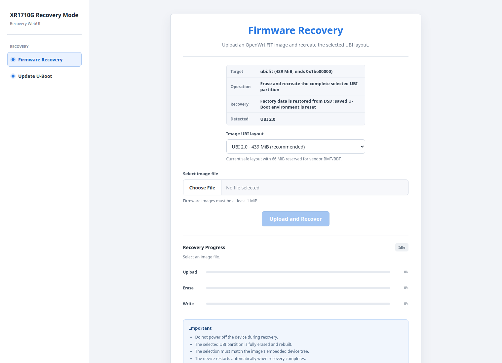

# XR1710G U-Boot

This is a customized U-Boot port for the XR1710G. Its main features are:

- 10GbE support
- HTTP Recovery for convenient web-based firmware flashing
- Built-in DHCP server so a connected PC can obtain an address automatically in recovery mode
- Recovery page address: `http://192.168.255.1`
- Read-only full SPI-NAND and individual MTD partition downloads at
  `http://192.168.255.1/backup.html`

## Flash Backup

Enter HTTP recovery as described below, then select **Flash Backup** in the
sidebar (or open `http://192.168.255.1/backup.html`). Choose the complete Flash
or a partition and click **Download Backup**. Capacity, physical offsets and
partition sizes are obtained from the current MTD devices, not hard-coded in
the page. Use the browser's download manager to check completion, then use
**Refresh Sources** to check whether the device is idle again.

- `GET /backup/info` returns device geometry, operation availability and the
  current MTD partitions with their indexes, offsets and sizes.
- `GET /backup/full.bin` streams the complete `spi-nand0` data area (512 MiB
  on XR1710G), including the vendor and reserved BMT/BBT regions.
- `GET /backup/mtd<N>.bin` streams one direct partition of `spi-nand0`.
  Use the index from `/backup/info`; U-Boot MTD indexes need not match Linux.

Downloads are ECC-corrected data-area images, **not raw NAND+OOB programmer
dumps**. No bad blocks are skipped, so physical offsets and the advertised
byte count are preserved. Correctable ECC warnings are accepted; an
uncorrectable error or short MTD read ends the HTTP stream early rather than
padding or silently omitting data. Always verify the final file size.

UBI 2.0, 1.5 and 1.0 are overlapping views starting at `0x00700000`, not
independent partitions. These are raw MTD exports, not individual UBI-volume
exports. The complete image is recommended for archival purposes. Do not
upload a full-Flash or partition dump as a firmware recovery FIT or a
chainloader update; restoration requires a separate, layout-aware procedure.

Backups use a 64 KiB page-aligned cache and stream directly to the browser's
download manager, without staging the entire image in U-Boot or JavaScript
RAM. One download at a time is allowed; uploads and downloads are mutually
exclusive. Backup endpoints never attach/format UBI, write Flash, save the
environment or reboot. Treat backups as private device data.

After editing the HTML, regenerate the committed embedded filesystem with
`sh tools/xr1710g-makefsdata.sh`.

## Flashing Summary

Use this section as the short operational checklist. The detailed background
and rationale are folded below.

### 1. HTTP Recovery Web Flash

Use this after the custom U-Boot is installed and you only want to update the
main OpenWrt firmware.

1. Connect the PC to the 10GbE port and leave the PC NIC in DHCP mode.
2. Power on the router.
3. Once the 10GbE port LED starts blinking, press and hold the `reset` button.
4. If you are unsure about the timing, wait a few more seconds. Because of the
   chainloader, there is a fairly large timing margin here.
5. Release the button after the status LED changes from solid red to the
   flowing recovery pattern.
6. Open `http://192.168.255.1`.
7. Select the upload target:
   - `firmware` writes the OpenWrt-generated `*-sysupgrade.itb` to `ubi:fit`.
   - `uboot` writes `xr1710g-chainloader-slot.bin` to the raw chainloader slot.
8. For a firmware upload, select the layout encoded in that image's embedded
   device tree: `UBI 2.0`, `UBI 1.5`, or `UBI 1.0`. The selector controls the
   erase/rebuild boundary; it does not convert or patch the uploaded image.
9. Full rebuild recreates `ubootenv`, `ubootenv2`, `fit`, and `rootfs_data`.
   Factory EEPROM and MAC data are restored from the vendor DSD region, while
   saved U-Boot environment values are reset.
10. Do not select a layout based only on the currently detected flash layout.
    The selection must match the new image. A mismatch can let U-Boot load the
    kernel but leave Linux waiting indefinitely for `/dev/fit0`.

Current HTTP Recovery page with the image-layout selector:



To inspect an OpenWrt FIT before uploading it, extract its FDT and read the
`ubi` partition size:

```sh
u-boot/tools/dumpimage -T flat_dt -p 1 -o /tmp/xr1710g.dtb firmware.itb
dtc -I dtb -O dts /tmp/xr1710g.dtb | grep -A2 'label = "ubi"'
```

Choose the WebUI value that matches the second `reg` cell:

| Embedded FDT `ubi` reg | WebUI selection |
|---|---|
| `<0x00700000 0x1b700000>` | `UBI 2.0` |
| `<0x00700000 0x1d9c0000>` | `UBI 1.5` |
| `<0x00700000 0x1f700000>` | `UBI 1.0` |

For example, if Linux prints an `ubi` end address of `0x1e0c0000`, the image
is `UBI 1.5`; rebuild it with `UBI 1.5`, even if U-Boot previously detected or
created a 1.0 layout. The characteristic failure is `not enough PEBs` followed
by `Waiting for root device /dev/fit0`.

Latest verified multi-layout recovery build (`59060dde`, 2026-07-12):

- Flash this file through the `uboot` target:
  `../build-artifacts/xr1710g-20260712/xr1710g-uboot-v2026.07-59060dde-flash-slot.bin`
  (`908778` bytes,
  SHA256 `0d2277d578dcb05c004475c1f653d3078c1672182994eeb5ad17d37b0dc4023c`)
- Bare chainloader FIT for RAM-only validation:
  `../build-artifacts/xr1710g-20260712/xr1710g-uboot-v2026.07-59060dde-chainloader.itb`
  (`900330` bytes,
  SHA256 `c2cfa064ed631cd4494e8a9f150923eddd1950bb74bfbdd7d7a9bb4fcd28cf34`)

The artifact name contains the source commit used by the embedded U-Boot:
`U-Boot 2026.07-00762-g59060dde7b91`.

Do not upload `u-boot.bin`, `u-boot.img`, or `xr1710g-ubi.img` through HTTP
Recovery. Use the named `*-flash-slot.bin` artifact (or the generic build
output `xr1710g-chainloader-slot.bin`) only with the `uboot` target.

> [!WARNING]
> - Do not flash `u-boot.bin` directly.
> - Do not treat `u-boot.img` as the final flash image.
> - The latest verified U-Boot/chainloader image is
>   `../build-artifacts/xr1710g-20260712/xr1710g-uboot-v2026.07-59060dde-flash-slot.bin`.
> - For main OpenWrt firmware, HTTP Recovery uses `*-sysupgrade.itb`, while
>   low-level raw flashing uses `out/xr1710g-ubi.img`.

### 2. OpenWrt / Linux `nandwrite` on the Legacy Layout

Use this when the device is still running Linux with the original vendor
layout and the active slot is still named `tclinux`.

Copy the image to the router:

```sh
scp out/xr1710g-chainloader-slot.bin root@<router-ip>:/tmp/
```

On the router:

```sh
grep -E 'tclinux|tclinux_slave' /proc/mtd

# If the primary slot is /dev/mtd5, back up and replace only its first 1 MiB.
nanddump -l 0x100000 -f /tmp/tclinux-head-1m.bin /dev/mtd5
flash_erase /dev/mtd5 0 8
nandwrite -p /dev/mtd5 /tmp/xr1710g-chainloader-slot.bin

sync
reboot
```

Do not use `sysupgrade` for this U-Boot/chainloader write, and do not overwrite
the whole `64 MiB` `tclinux` slot.

### 3. ECNT Stock U-Boot Prompt

Use the stock ECNT / AXON prompt to verify environment and RAM boot behavior.

Expected boot-critical environment:

```sh
printenv bootcmd loadaddr fdt_high

setenv loadaddr 0x81800000
setenv fdt_high 0xac000000
setenv bootcmd 'flash read 0x602100 0x4000000 $loadaddr; bootm'
saveenv
```

The current slot image is dual-entry. The ECNT stock command above enters the
FIT at `0x602100`; older environments that read from `0x600000` and run
no-argument `bootm` enter a small legacy prefix shim instead.

RAM-only TFTP validation with the slot image:

```sh
setenv ipaddr 192.168.0.1
setenv serverip 192.168.0.205
tftpboot 0x81800000 xr1710g-chainloader-slot.bin
bootm 0x81802100
```

RAM-only TFTP validation with the bare FIT artifact:

```sh
setenv ipaddr 192.168.0.1
setenv serverip 192.168.0.205
tftpboot 0x81800000 xr1710g-chainloader.itb
bootm 0x81800000
```

### 4. Migration from `w1700k-ubi-installer`

If the first-stage boot command was changed by the older installer, fix it
before expecting the current `xr1710g-chainloader-slot.bin` to boot
automatically.

Check the current command:

```sh
printenv bootcmd
```

Use one of these compatible forms:

```sh
setenv bootcmd 'flash read 0x602100 0x100000 $loadaddr; bootm 0x81800000'
saveenv
```

or:

```sh
setenv bootcmd 'flash read 0x600000 0x100000 $loadaddr; bootm'
saveenv
```

or:

```sh
setenv bootcmd 'flash read 0x600000 0x100000 $loadaddr; bootm 0x81802100'
saveenv
```

Then use the OpenWrt/Linux `nandwrite` flow above or a known-good vendor update
path to write the actual image.

<details>
<summary>Flash image notes</summary>

## Flash Image Notes

- `out/u-boot.bin`
  The raw secondary U-Boot payload produced by the build.
- `u-boot.img`
  One of the standard U-Boot build artifacts, but not the final flash image for the XR1710G boot chain.
- `out/xr1710g-chainloader.itb`
  An intermediate FIT-packaged artifact. It is usually not written to flash directly.
- `out/xr1710g-chainloader-slot.bin`
  The image that is actually written to the `chainloader` partition.
- `../build-artifacts/xr1710g-YYYYMMDD/*-flash-slot.bin`
  Archived, commit-named copies of the verified flashable slot image. Prefer
  the exact latest path listed in the flashing summary above.

Upstream reference:

- OpenWrt PR `#22397`: <https://github.com/openwrt/openwrt/pull/22397>

> [!WARNING]
> - Do not flash `u-boot.bin` directly
> - Do not treat `u-boot.img` as the final flash image
> - The final image to flash is the packaged `xr1710g-chainloader-slot.bin`

</details>

<details>
<summary>ECNT stock U-Boot details</summary>

## Flash From ECNT Stock U-Boot

This section applies to units still using the original ECNT / AXON first-stage
U-Boot. The known stock environment reports:

```sh
ver=U-Boot 2014.04-rc1 (Mar 15 2024 - 15:13:21) AXON 1.6
version=1.6
vendor=ecnt
board=an7581_evb
loadaddr=0x81800000
fdt_high=0xac000000
bootcmd=flash read 0x602100 0x4000000 $loadaddr; bootm
ipaddr=192.168.0.1
serverip=192.168.0.205
bootfile=tclinux.bin
kernel_filename=tclinux.bin
uboot_filename=tcboot.bin
```

For this stock environment, keep the default `bootcmd` unchanged. The current
slot image is dual-entry:

- flash offset `0x600000` contains a small legacy bootm prefix shim
- flash offset `0x602100` contains the full chainloader FIT

The ECNT default command enters the FIT directly:

```sh
flash read 0x602100 0x4000000 $loadaddr
bootm
```

If the boot-critical variables do not match the values above, check only the
minimal set first:

```sh
printenv bootcmd loadaddr fdt_high
```

For the current chainloader slot image, the expected values are:

```sh
bootcmd=flash read 0x602100 0x4000000 $loadaddr; bootm
loadaddr=0x81800000
fdt_high=0xac000000
```

To change a mismatched ECNT first-stage environment back to these values:

```sh
setenv loadaddr 0x81800000
setenv fdt_high 0xac000000
setenv bootcmd 'flash read 0x602100 0x4000000 $loadaddr; bootm'
saveenv
reset
```

Do not copy a full `printenv` from another device. Board-specific values such
as `ethaddr`, `bootargs`, GPIO settings, serial data, and vendor/product fields
should be preserved unless there is a separate reason to change them.

The image to write is still:

```text
out/xr1710g-chainloader-slot.bin
```

The older `0x600000` no-argument form is also supported by the current
dual-entry slot image:

```sh
flash read 0x600000 0x100000 $loadaddr
bootm
```

In this mode, `bootm` starts the legacy prefix shim at `$loadaddr`; that shim
then locates the FIT at `$loadaddr + 0x2100` and jumps to the embedded
second-stage U-Boot payload.

After flashing the slot image, the ECNT prompt can be used to validate the
first-stage handoff manually:

```sh
printenv ver version vendor board bootcmd loadaddr fdt_high
flash read 0x600000 0x100 0x81800000
md.b 0x81800000 0x20
flash read 0x602100 0x4000000 $loadaddr
bootm
```

The expected magic bytes for a correctly flashed current slot image are:

- at flash offset `0x600000`: `27 05 19 56` (`IH_MAGIC`, legacy prefix shim)
- at flash offset `0x602100`: `d0 0d fe ed` (`FDT_MAGIC`, chainloader FIT)

If `bootcmd=flash read 0x602100 ...; bootm` prints `Wrong Image Format`, the
first thing to check is the second magic value above. If `0x602100` is not
`d0 0d fe ed`, the ECNT environment is not the cause; the chainloader slot was
not written with the current `out/xr1710g-chainloader-slot.bin`, or it was
written at the wrong offset.

If variable expansion is inconvenient, use the default address explicitly:

```sh
flash read 0x602100 0x4000000 0x81800000
bootm 0x81800000
```

The earlier bug where the log reached `Starting kernel ...` and then stopped
was observed on this same AXON 1.6 stock U-Boot line. In that failure mode the
shim could be entered from a FIT image reported at `0x89000000`, while the
control DTB still used the default `fit-base = 0x81800000`. The current shim
keeps `0x81800000` as the default and adds a fallback search for the AXON 1.6
handoff address, so the ECNT environment should not be changed just to work
around that bug.

The ECNT `flash` command is vendor-specific. This README intentionally does
not provide an unverified raw `flash write` command for the stock prompt; use a
known-good vendor update path or the OpenWrt `nandwrite` flow below for the
persistent write.

</details>

<details>
<summary>Migration from w1700k-ubi-installer details</summary>

## Migration From `w1700k-ubi-installer`

If the device is being switched from the older `w1700k-ubi-installer` path to
the current XR1710G chainloader layout, the first-stage vendor U-Boot
environment must be checked and usually updated.

The older installer commonly left the first-stage environment with:

```sh
bootcmd=flash read 0x600000 0x100000 $loadaddr; bootm
```

That command matched the older `openwrt-airoha-an7581-gemtek_w1700k-ubi-chainload-uboot.itb`
flow where the FIT image started directly at `0x600000`.

Older single-entry `xr1710g-chainloader-slot.bin` builds kept a vendor
`0x2100`-byte slot prefix and placed the FIT at `0x602100`, so the old
no-argument `bootm` form was not compatible. Current builds are dual-entry:
the slot starts with a legacy bootm prefix shim and still keeps the FIT at
`0x602100`.

Before expecting automatic boot to work, inspect the current setting in the
first-stage prompt:

```sh
printenv bootcmd
```

The following first-stage forms are confirmed to work with the current
`xr1710g-chainloader-slot.bin`:

```sh
flash read 0x600000 0x100000 0x81800000
bootm 0x81800000
```

or:

```sh
flash read 0x602100 0x100000 0x81800000
bootm 0x81800000
```

or:

```sh
flash read 0x600000 0x100000 0x81800000
bootm 0x81802100
```

To update the persistent first-stage environment, use one of these `bootcmd`
values:

```sh
setenv bootcmd 'flash read 0x600000 0x100000 $loadaddr; bootm'
saveenv
```

or:

```sh
setenv bootcmd 'flash read 0x602100 0x100000 $loadaddr; bootm 0x81800000'
saveenv
```

or:

```sh
setenv bootcmd 'flash read 0x600000 0x100000 $loadaddr; bootm 0x81802100'
saveenv
```

</details>

<details>
<summary>Current partition layout details</summary>

## Current Partition Layout

The three supported UBI layouts share the same `vendor` and `chainloader`
partitions. Only the UBI end boundary differs:

| Version | U-Boot MTD view | UBI start | UBI size | Reserved tail |
|---|---|---:|---:|---:|
| `UBI 2.0` | `ubi` | `0x00700000` | `0x1B700000` | `0x04200000` (528 PEB) |
| `UBI 1.5` | `ubi1.5` | `0x00700000` | `0x1D9C0000` | `0x01F40000` (250 PEB) |
| `UBI 1.0` | `ubi1.0` | `0x00700000` | `0x1F700000` | `0x00200000` (16 PEB) |

`vendor` is `0x00000000 + 0x00600000`; `chainloader` is
`0x00600000 + 0x00100000`. New builds default to `UBI 2.0`.

Inside `vendor`, the original vendor layout is still preserved:

- `bootloader`: `0x00000000-0x001FFFFF`
- `uenv`: `0x00200000-0x003FFFFF`
- `dsd`: `0x00400000-0x005FFFFF`

The `UBI 2.0` boundary follows the conservative 528-PEB reservation used by
the local OP integration. Migration between versions must fully rebuild UBI;
flashing only the `fit`/sysupgrade volume is not sufficient or safe. OpenWrt
PR `#22397` is still unmerged and currently carries the older 16-PEB boundary;
it is not evidence for the local `UBI 2.0` size.

The WebUI layout choice must match the partition size in the uploaded FIT's
embedded FDT, not merely this U-Boot's current MTD view. U-Boot can read a
`fit` volume from a larger layout while the Linux DTS exposes a smaller MTD
partition; Linux then rejects the UBI volume table because its reserved PEB
count exceeds the DTS-defined partition.

</details>

<details>
<summary>OpenWrt legacy tclinux flashing details</summary>

## Flashing the Primary `tclinux` Slot from OpenWrt

The following commands are intended for the case where:

- the device is still using the original legacy vendor partition layout
- there is not yet a dedicated `chainloader` partition
- you want to write `out/xr1710g-chainloader-slot.bin` into the primary `tclinux` slot

First, confirm that the partition names still match the old layout:

```sh
grep -E 'tclinux|tclinux_slave' /proc/mtd
```

If the primary slot is still `tclinux`, it is typically `/dev/mtd5`. It is recommended to overwrite only the first `1 MiB` of that slot. Do not use `sysupgrade`, and do not directly `mtd write ... tclinux` over the entire `64 MiB` slot.

Assuming the image has already been copied to `/tmp/xr1710g-chainloader-slot.bin` on the device, run:

```sh
# Optional: back up the first 1 MiB of the primary slot
nanddump -l 0x100000 -f /tmp/tclinux-head-1m.bin /dev/mtd5

# Erase the first 1 MiB (8 erase blocks of 128 KiB each)
flash_erase /dev/mtd5 0 8

# Write the chainloader slot image to the start of the primary slot
nandwrite -p /dev/mtd5 /tmp/xr1710g-chainloader-slot.bin

sync
reboot
```

Additional notes:

- The image written here is `out/xr1710g-chainloader-slot.bin`, not `u-boot.bin`
- These commands apply to the old layout where the primary slot is `tclinux`
- If the device has already been migrated to the new `vendor + chainloader + ubi` layout, write the `chainloader` partition directly instead of writing `tclinux`

</details>

<details>
<summary>Why the raw build artifact cannot be flashed directly</summary>

## Why the Raw Build Artifact Cannot Be Flashed Directly

The vendor boot chain follows a `bootm` path and cannot boot a bare `u-boot.bin` directly.

Because of that, the U-Boot in this project is used as a secondary payload. An outer wrapper with a Linux `Image`-style header and a chainloader package must be added so that the vendor `bootm` path will accept it. That outer wrapper first boots a shim, and the shim then jumps to the real `u-boot.bin`.

In other words, the U-Boot artifact produced by the build cannot be flashed directly. It must first be packaged into a chainloader image with the required Linux-style header.

</details>

<details>
<summary>Packaging files and build commands</summary>

## Files Required for Packaging

To package the raw U-Boot payload into a flashable chainloader image, prepare:

- Raw secondary payload: `u-boot.bin`
- Vendor slot image, for example `mtd5_tclinux.bin`
  Used as a reference input when building the slot image
- Prefix shim: `chainloader-prefix-shim.uImage`
  Provides compatibility with legacy `flash read 0x600000 ...; bootm`
- Shim: `chainloader-shim.bin`
- Control DTB: `chainloader-control.dtb`
- `u-boot/tools/mkimage`
- `u-boot/tools/dumpimage`

The resulting packaged artifacts are typically:

- `out/xr1710g-chainloader.itb`
- `out/xr1710g-chainloader-slot.bin`

Reference: simplified `build-chainloader-fit.sh` script contents, keeping only the core packaging logic:

```sh
#!/usr/bin/env sh
set -eu

stock_slot=xr1710g-backup/mtd5_tclinux.bin
prefix_shim=out/chainloader-prefix-shim.uImage
shim=out/chainloader-shim.bin
payload=out/u-boot.bin
dtb=out/chainloader-control.dtb
output_fit=out/xr1710g-chainloader.itb
output_slot=out/xr1710g-chainloader-slot.bin
mkimage=u-boot/tools/mkimage
dumpimage=u-boot/tools/dumpimage
template=xr1710g-chainloader.its.in
tmpdir=$(mktemp -d)
its="$tmpdir/xr1710g-chainloader.its"

sed \
  -e "s|__DTB__|$dtb|g" \
  -e "s|__SHIM__|$shim|g" \
  -e "s|__PAYLOAD__|$payload|g" \
  -e "s|__KCOMP__|none|g" \
  "$template" > "$its"

"$mkimage" -f "$its" "$output_fit"
"$dumpimage" -l "$output_fit"

# Place a legacy bootm prefix shim at slot offset 0, pad it to 0x2100 bytes,
# then append the full chainloader FIT image.
prefix_size=$(wc -c < "$prefix_shim")
cp "$prefix_shim" "$output_slot"
dd if=/dev/zero bs=1 count=$((0x2100 - prefix_size)) >> "$output_slot" 2>/dev/null
cat "$output_fit" >> "$output_slot"

```

</details>

<details>
<summary>Reference projects</summary>

## Reference Projects

- U-Boot official homepage: <https://u-boot.org/>
- U-Boot official documentation: <https://docs.u-boot.org/>
- U-Boot official source repository: <https://source.denx.de/u-boot/u-boot>

</details>
